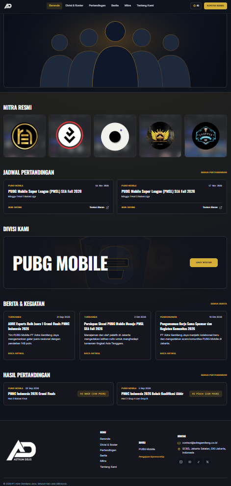
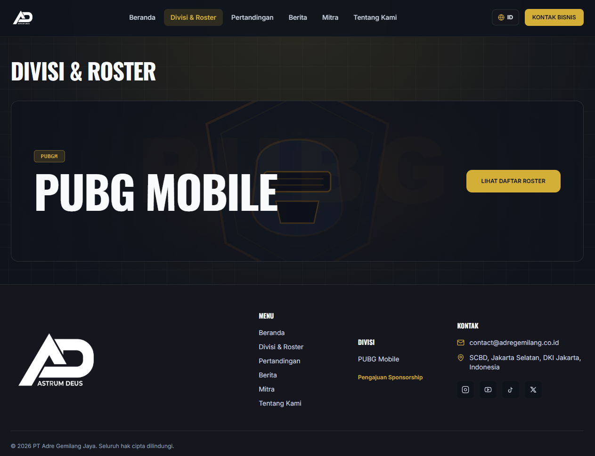
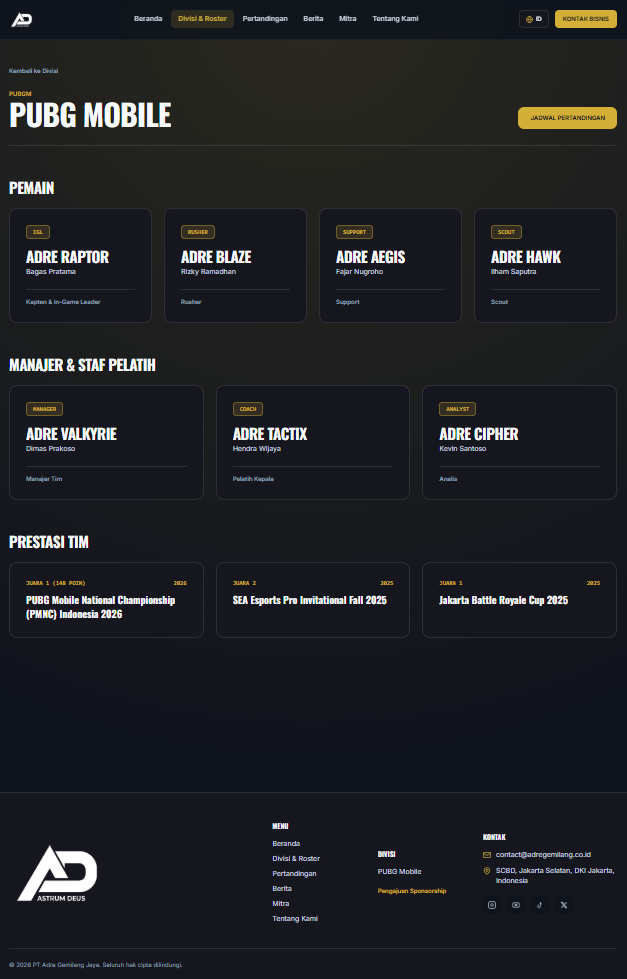
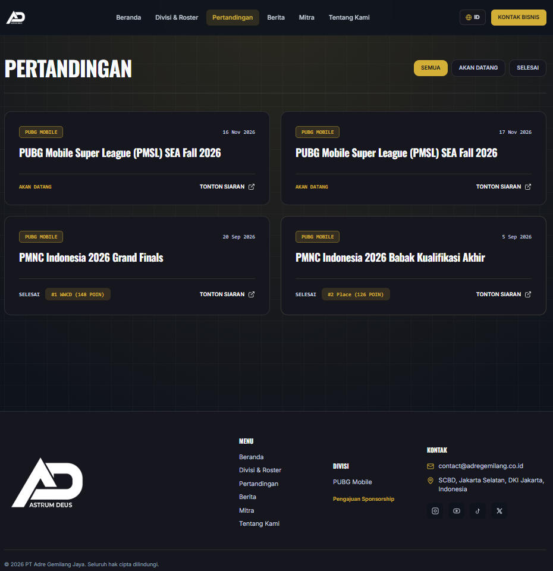
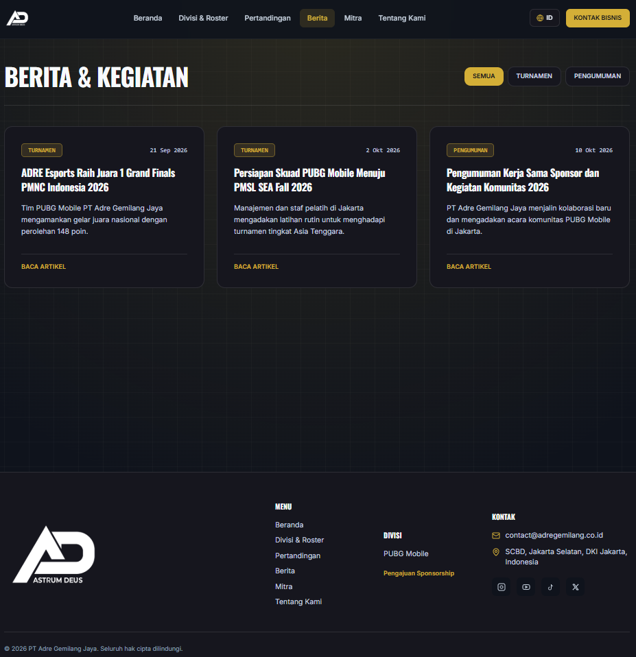
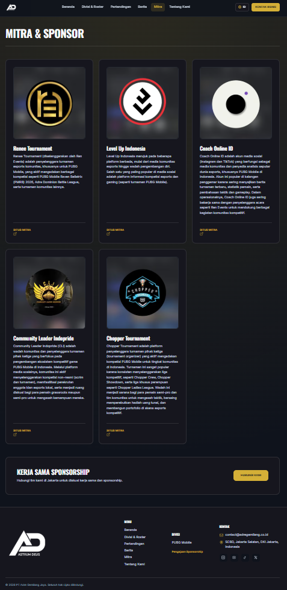
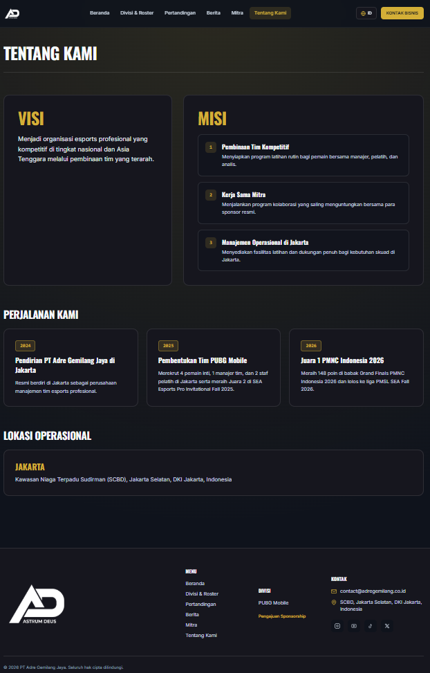
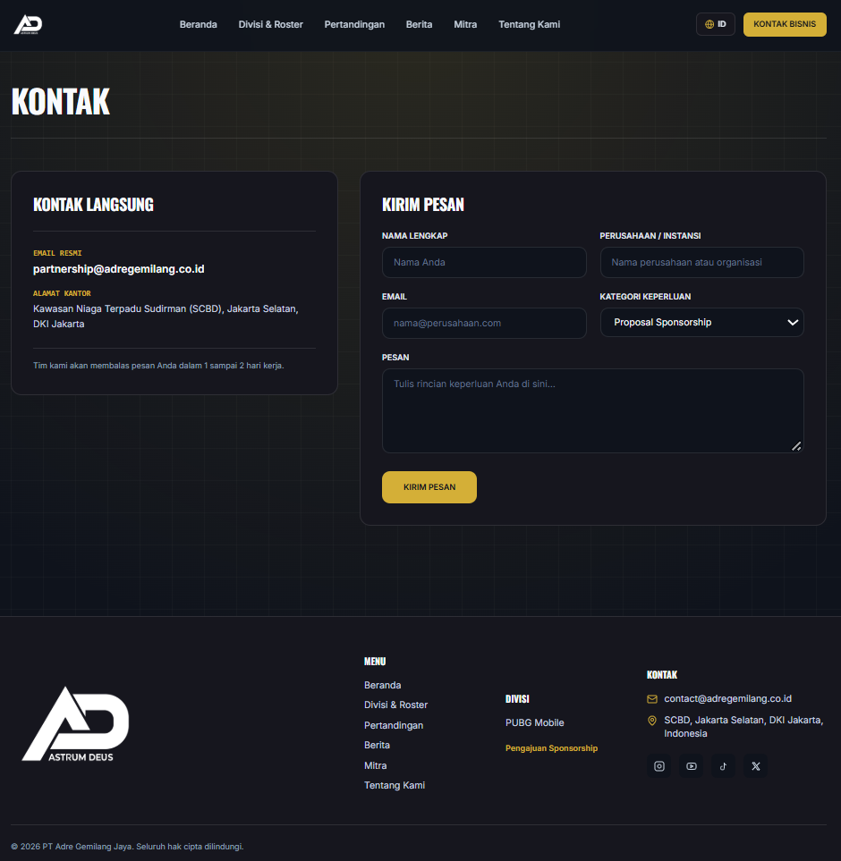

# 1. Nama Project
**Portal Web Company Profile — PT Adre Gemilang Jaya**

---

## 2. Deskripsi Singkat
Aplikasi web *Company Profile* resmi untuk **PT Adre Gemilang Jaya**, sebuah perusahaan manajemen tim esports. Portal ini dirancang sebagai pusat informasi digital yang menampilkan profil organisasi, daftar skuad divisi **PUBG Mobile** (pemain inti, manajer, dan staf pelatih), jadwal serta hasil turnamen, berita kegiatan terbaru, etalase mitra komersial, hingga layanan pengajuan kerja sama bisnis (*sponsorship*) dalam dua bahasa (Indonesia & Inggris).

---

## 3. Problem yang Diselesaikan
1. **Sentralisasi Informasi Kompetitif & Korporat**: Sebelumnya, informasi mengenai susunan pemain (*roster*), jadwal tanding, dan pencapaian turnamen tersebar di berbagai kanal media sosial. Website ini menyatukan seluruh informasi tersebut ke dalam satu portal resmi yang terstruktur dan mudah diakses.
2. **Peningkatan Kredibilitas di Mata Sponsor & Mitra Bisnis**: Calon sponsor membutuhkan profil perusahaan yang jelas sebelum menjalin kerja sama. Portal ini menyediakan halaman khusus Mitra Resmi, Visi & Misi perusahaan, rekam jejak prestasi, serta formulir pengajuan kemitraan terdedikasi.
3. **Jangkauan Audiens Lokal & Internasional**: Industri esports melibatkan penyelenggara turnamen dan mitra dari dalam maupun luar negeri. Dukungan dwibahasa instan (Bahasa Indonesia & Bahasa Inggris) memastikan seluruh informasi dapat dipahami oleh berbagai pihak tanpa kendala bahasa.
4. **Keamanan Integrasi Data Front-End & CMS**: Untuk mencegah ketidakcocokan struktur data saat dihubungkan dengan *Content Management System* (CMS), proyek ini menerapkan validasi kontrak skema data (*API Data Contract*) yang ketat serta pengujian unit otomatis.

---

## 4. Fitur - Fitur
- **Beranda (`/`)**:
  - Banner visual utama skuad PT Adre Gemilang Jaya dengan optimasi pemuatan prioritas tinggi (*High Fetch Priority*).
  - Etalase **5 Mitra Resmi** dengan tampilan logo persegi penuh (*full-card square logo*).
  - Ringkasan jadwal pertandingan mendatang (*Upcoming Matches*) dan hasil pertandingan terbaru (*Match Results*) dengan format skor *Battle Royale* (`#1 WWCD + Poin`).
  - Banner interaktif divisi **PUBG MOBILE** berlatar belakang grafis logo PUBG dan pintasan menuju halaman roster.
  - Sorotan 3 artikel berita dan kegiatan terbaru organisasi.
- **Katalog Divisi & Detail Roster (`/teams` & `/teams/pubg-mobile`)**:
  - Katalog divisi aktif dengan tipografi tegas dan latar belakang tematik PUBG Mobile.
  - Pemisahan struktur skuad secara otomatis menjadi **4 Pemain** (*IGL, Rusher, Support, Scout*) dan **3 Manajer & Staf Pelatih** (*Manager, Coach, Analyst*).
  - Kartu profil personel interaktif yang dilengkapi animasi *smooth hover photo background*.
  - Daftar rekam jejak prestasi resmi tim.
- **Jadwal & Hasil Pertandingan (`/matches`)**:
  - Fitur penyaringan (*filter*) instan berdasarkan status pertandingan (*Semua*, *Akan Datang*, *Selesai*).
  - Informasi turnamen lengkap dengan penanda waktu terlokalisasi, lencana poin akhir, dan tautan siaran langsung (*live stream*).
- **Berita & Kegiatan (`/news` & `/news/[slug]`)**:
  - Fitur filter artikel berdasarkan kategori (*Semua*, *Turnamen*, *Pengumuman*).
  - Halaman baca artikel lengkap dengan metadata SEO dinamis dan rekomendasi berita terkait.
- **Mitra & Sponsor (`/partners`)**:
  - Katalog **5 Mitra Resmi** (termasuk *Renee Tournament*) yang menampilkan visual logo persegi, deskripsi peran kemitraan, tautan menuju situs mitra, serta *banner* ajakan kolaborasi *sponsorship*.
- **Tentang Kami (`/about`)**:
  - Penjabaran **Visi** dan **3 Misi Utama** perusahaan, linimasa perjalanan organisasi (*2024–2026*), serta informasi alamat kantor manajemen dan fasilitas latihan di Jakarta.
- **Kontak Bisnis (`/contact`)**:
  - Informasi kontak langsung manajemen PT Adre Gemilang Jaya di kawasan SCBD, Jakarta Selatan.
  - Formulir pengajuan kerja sama dengan 3 kategori keperluan (*Proposal Sponsorship*, *Undangan Turnamen*, *Pertanyaan Umum*) yang dilengkapi validasi input sisi klien.
- **Sistem Dwibahasa Instan (ID / EN)**:
  - Pengalih bahasa (*Language Switcher*) Indonesia dan Inggris secara *real-time* tanpa memuat ulang halaman, tersimpan otomatis di `localStorage`.

---

## 5. Screenshot

| Halaman                                     | Pratinjau Tampilan                                                    |
|---------------------------------------------| ----------------------------------------------------------------------|
| **1. Beranda (`/`)**                        |                 |
| **2. Katalog Divisi (`/teams`)**            |                 |
| **3. Detail Roster (`/teams/pubg-mobile`)** |  |
| **4. Pertandingan (`/matches`)**            |         |
| **5. Berita & Kegiatan (`/news`)**          |                  |
| **6. Mitra & Sponsor (`/partners`)**        |               |
| **7. Tentang Kami (`/about`)**              |           |
| **8. Kontak Bisnis (`/contact`)**           |               |

---

## 6. Tech Stack + Alasan Pemilihan

| Teknologi | Alasan Penggunaan |
| :--- | :--- |
| **Next.js 16 (App Router)** | Mendukung *Server-Side Rendering* (SSR) dan *Static Site Generation* (SSG) untuk menghasilkan performa muat halaman yang sangat cepat (*Core Web Vitals* optimal), optimasi gambar otomatis melalui `next/image`, serta visibilitas SEO yang kuat di mesin pencari. |
| **TypeScript** | Menjaga keamanan tipe data (*static type-checking*) di seluruh komponen antarmuka dan fungsi pengolah data, sehingga meminimalkan potensi *bug* atau *error* saat aplikasi dijalankan di lingkungan produksi. |
| **Tailwind CSS** | Mempercepat pembangunan desain antarmuka bertema gelap (*dark-mode esports aesthetic*) yang konsisten dan responsif di berbagai ukuran layar (*mobile-first*) dengan ukuran bundel CSS akhir yang sangat kecil. |
| **Zod** | Digunakan sebagai lapisan validasi skema kontrak API (*API-01* hingga *API-07*) dan validasi formulir kemitraan bisnis, memastikan data yang masuk dari CMS maupun input pengguna selalu sesuai format yang diharapkan. |
| **Vitest** | *Testing framework* modern yang sangat cepat dan kompatibel penuh dengan ekosistem TypeScript untuk menjalankan pengujian unit otomatis (*automated unit testing*) pada logika pemformatan skor, filter data, dan validasi skema. |

---

## 7. Cara Install / Run

Ikuti langkah-langkah berikut untuk menjalankan proyek ini di komputer lokal:

### Prasyarat
- **Node.js** versi `18.18.0` atau lebih baru (disarankan versi `20 LTS`).
- **npm** (bawaan instalasi Node.js) dan **Git**.

### Langkah Instalasi & Menjalankan Aplikasi

1. **Clone repositori proyek**:
   ```bash
   git clone <url-repository-anda>
   cd adre-gemilang-jaya
   ```

2. **Instal seluruh dependensi paket**:
   ```bash
   npm install
   ```

3. **Konfigurasi variabel lingkungan (Opsional untuk integrasi CMS)**:
   Buat berkas `.env.local`[cite: 2] di direktori utama jika ingin menghubungkan aplikasi ke server API CMS:
   ```env
   NEXT_PUBLIC_API_BASE_URL=[https://api.adregemilang.co.id/v1](https://api.adregemilang.co.id/v1)
   ```

4. **Jalankan server pengembangan (*Development Server*)**:
   ```bash
   npm run dev
   ```
   Buka peramban dan akses alamat `http://localhost:3000`[cite: 2].

5. **Jalankan pengujian unit (Vitest) & pemeriksaan tipe TypeScript**:
   ```bash
   npx vitest run && npx tsc --noEmit
   ```

6. **Bangun dan jalankan bundel produksi (*Production Build*)**:
   ```bash
   npm run build
   npm run start
   ```